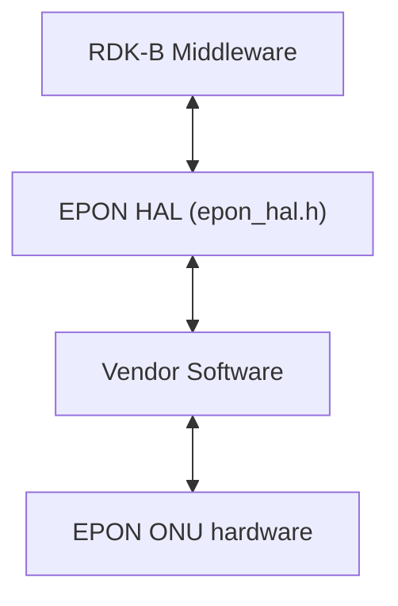
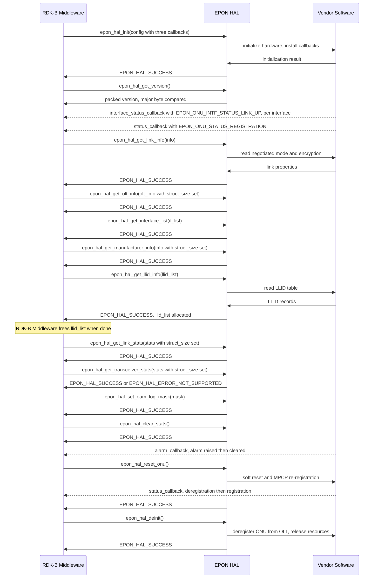
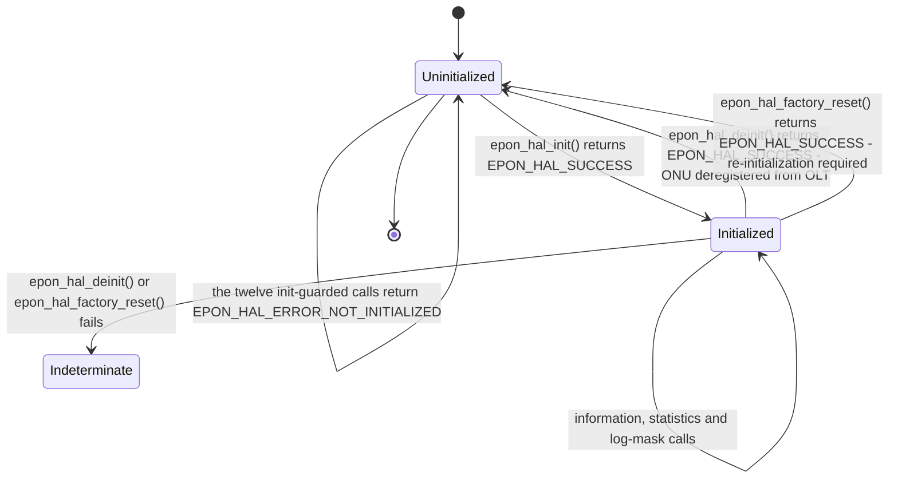
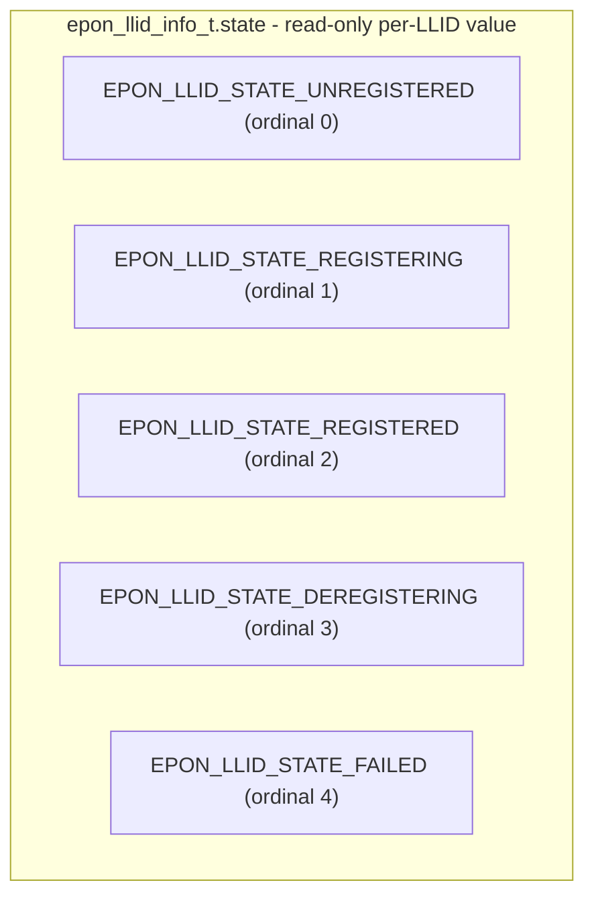

# EPON HAL Documentation

## Version History

| Date | Comment | Version |
| --- | --- | --- |
| 2026-08-25 | First specification document for the EPON HAL. Covers the runtime execution requirements, the non-functional requirements, the complete public type surface and all fifteen declared functions. Describes release tag `v1.0.0` at interface version `1.0.0`. | 1.0.0 |

## Acronyms

- `HAL` \- Hardware Abstraction Layer
- `RDK-B` \- Reference Design Kit for Broadband Devices
- `API` \- Application Programming Interface
- `ABI` \- Application Binary Interface
- `PON` \- Passive Optical Network
- `EPON` \- Ethernet Passive Optical Network
- `WAN` \- Wide Area Network, the operator-facing side of the gateway
- `ONU` \- Optical Network Unit, the subscriber-side device this interface
  abstracts
- `OLT` \- Optical Line Terminal, the operator-side device the `ONU` registers
  with
- `LLID` \- Logical Link Identifier
- `MPCP` \- Multi-Point Control Protocol
- `OAM` \- Operations, Administration and Maintenance
- `DOCSIS` \- Data Over Cable Service Interface Specification
- `DPoE` \- DOCSIS Provisioning of EPON
- `CPE` \- Customer Premises Equipment
- `FEC` \- Forward Error Correction
- `MAC` \- Media Access Control
- `OUI` \- Organizationally Unique Identifier
- `AES` \- Advanced Encryption Standard
- `TR-181` \- Broadband Forum Device Data Model

## Description

The diagram below describes a high-level software architecture of the EPON HAL
module stack.

The EPON `HAL` is the interface definition between the RDK-B Middleware, the
caller throughout this document, and a vendor's implementation of an Ethernet
`PON` `ONU` on the `WAN` side of the gateway. It exposes link and `LLID`
information, `ONU` reset, transceiver and link statistics, `OLT` and
manufacturer information, and `OAM` log masking, plus one `DPoE` call for the
`CPE` `MAC` table.

The RDK-B Middleware links the interface and calls it directly, with no
dedicated middleware service between them.

## Optional Components

`DPoE` is the one optional part of this interface. Its surface is:

- `dpoe_hal_get_cpe_mac_table`, which returns the `CPE` `MAC` address table;
- `dpoe_cpe_mac_type_t`, `dpoe_cpe_mac_entry_t` and `dpoe_cpe_mac_table_t`, the
  types that table uses;
- `epon_vendor_alarm_t`, the vendor-specific alarms the header attributes to
  `DPoE`, delivered through `alarm_callback` with `alarm_type` set to
  `EPON_ALARM_TYPE_VENDOR_SPECIFIC`.

`DPoE` availability is decided at runtime. The caller states its requirement
through `epon_hal_config_t.dpoe_supported` at initialization, and
`dpoe_hal_get_cpe_mac_table` returns `EPON_HAL_ERROR_NOT_SUPPORTED` on a
platform without `DPoE`.

## Component Runtime Execution Requirements

These requirements ensure that the `HAL` executes correctly within the run-time
environment in which it is used.

### Initialization and Startup

The interface has an explicit lifecycle, and its ordering is a requirement:

- `epon_hal_init()` must return `EPON_HAL_SUCCESS` before any other function is
  called. It takes a non-`NULL` pointer to a caller-allocated
  `epon_hal_config_t` whose `struct_size` is set to the size of that structure,
  installs the three callbacks, configures `DPoE` support where requested, and
  initializes the interface mapping.
- `epon_hal_deinit()` unregisters the callbacks, releases the implementation's
  allocations, performs hardware cleanup and deregisters the `ONU` from the
  `OLT`. `epon_hal_init()` must be called again before any other function is
  used.
- `epon_hal_factory_reset()` also ends the initialized lifetime: after a
  successful factory reset, `epon_hal_init()` must be called again.

The optical hardware must be present and provisioned for EPON before
`epon_hal_init()` is called. Callbacks may fire before `epon_hal_init()`
returns, so the caller has its callback bodies ready first.

On any failure code from `epon_hal_init()` the interface is not initialized and
there is no partial state to unwind; the caller does not call
`epon_hal_deinit()` to clean up. The caller action for each code is given under
`Internal Error Handling`.

Immediately after a successful `epon_hal_init()`, and before any other call, the
caller reads `epon_hal_get_version()` and confirms `ABI` compatibility as
`Variability Management` describes.

### Threading Model

The caller serialises its calls into the interface. In particular:

- `epon_hal_init()` and `epon_hal_deinit()` are never called concurrently, and
  the caller quiesces its own use of the interface before calling
  `epon_hal_deinit()` or `epon_hal_factory_reset()`.
- `epon_hal_clear_stats()` is never run concurrently with
  `epon_hal_get_link_stats()`.
- A callback body copies what it needs and returns quickly, rather than
  blocking or calling back into the `HAL`.

Vendors may implement internal threading and event mechanisms to meet their
operational requirements. These mechanisms must be thread safe when interacting
with the interface.

### Process Model

The interface is a single global instance per process. No function takes a
handle or context argument, `epon_hal_init()` takes only its configuration and
`epon_hal_deinit()` takes no argument, so initialization state belongs to the
process and a caller cannot open two independent sessions.

`epon_hal_deinit()` deregisters the `ONU` from the `OLT`, so its effect reaches
every user of the optical link, not only the calling process.

### Memory Model

The caller owns every structure it passes in. Only two arrays, allocated by the
implementation, transfer ownership to the caller.

#### Caller Responsibilities

- Allocate every structure passed to a function; the implementation fills it.
- Set `struct_size` to the size of the structure on each structure that carries
  it, marked under `Data Structures and Defines`. An unset or wrong value
  returns `EPON_HAL_ERROR_INVALID_PARAM`.
- Free `epon_llid_list_t.llid_list` after `epon_hal_get_llid_info()` and
  `dpoe_cpe_mac_table_t.cpe_list` after `dpoe_hal_get_cpe_mac_table()`.
- Keep the `epon_hal_config_t` passed to `epon_hal_init()` valid for the
  initialized lifetime.
- Copy any data needed from the `alarm_callback` argument before the callback
  returns; never store or free that pointer.
- Read fixed-size character fields within their declared lengths.

#### Module Responsibilities

- Allocate `llid_list` and `cpe_list` for the caller to free.
- Manage internal memory without leaks, and release everything the
  implementation allocated when `epon_hal_deinit()` is called.

### Power Management Requirements

The interface declares no power-management function and plays no role in system
power transitions. Imminent power loss is reported to the caller as
`EPON_VENDOR_ALARM_DYING_GASP` through `alarm_callback`, a notification the
caller may act on rather than a power control.

### Asynchronous Notification Model

Three callbacks carry asynchronous notification. They are function-pointer
members of `epon_hal_config_t`, installed only by `epon_hal_init()`, so changing
one requires `epon_hal_deinit()` and a new `epon_hal_init()`. Each may be `NULL`
where the caller wants no notification of that kind.

- `status_callback` receives an `epon_onu_status_t` by value when the aggregate
  `ONU` status changes: `EPON_ONU_STATUS_LOS` where no signal is detected,
  `EPON_ONU_STATUS_DOWNSTREAM_SIGNAL_DETECTED` where optical power is present
  but the `ONU` is not registered, `EPON_ONU_STATUS_REGISTRATION` where LLID-0
  is online including `MPCP` and `OAM`, and `EPON_ONU_STATUS_DEREGISTRATION`
  where LLID-0 has gone offline.
- `alarm_callback` receives a `const epon_alarm_info_t` pointer when an alarm is
  raised or cleared. `alarm_type` selects the standard `epon_hal_alarm_t` or the
  vendor `epon_vendor_alarm_t` member of its anonymous union; `llid` is the
  affected `LLID`, or `EPON_LLID_NOT_APPLICABLE` for a device-wide alarm; and
  `is_active` distinguishes a raise from a clear.
- `interface_status_callback` receives an `epon_onu_interface_info_t` by value
  when one layer-2 interface changes link state. On a device with several `WAN`
  interfaces it fires once per interface, identified by its `name`, such as
  `veip0`.

### Blocking calls

- `epon_hal_init()` may block. It returns `EPON_HAL_ERROR_TIMEOUT` where
  initialization blocks for more than three minutes, so the caller sizes its
  start-up budget accordingly.
- Every function returns its result synchronously; notifications arrive
  separately through the callbacks.
- `epon_hal_reset_onu()` returns once the reset is initiated. Registration then
  completes asynchronously, and the caller observes it through `status_callback`
  reaching `EPON_ONU_STATUS_REGISTRATION`.
- `epon_hal_deinit()` deregisters from the `OLT` through a protocol exchange, and
  `epon_hal_factory_reset()` resets the hardware. A caller that cannot wait
  indefinitely bounds these calls itself.

### Internal Error Handling

A caller learns of each failure from the return value of the call that failed.
`epon_hal_get_version()` returns a packed version value and cannot fail; every
other function returns its outcome as an `epon_hal_return_t` status. Success is
zero and every failure is negative, so a sign test detects failure, while a
caller switches on the specific code where recovery differs.

| Code | Value | Meaning | What the caller should do |
| --- | --- | --- | --- |
| `EPON_HAL_SUCCESS` | 0 | Operation completed successfully. | Proceed; the output structure is populated. |
| `EPON_HAL_ERROR_INVALID_PARAM` | -1 | Invalid parameter provided. | Fix the call. A `NULL` pointer or an unset `struct_size` is the usual cause. Not retryable. |
| `EPON_HAL_ERROR_NOT_INITIALIZED` | -2 | The interface is not initialized. | Call `epon_hal_init` first, then retry. |
| `EPON_HAL_ERROR_HW_FAILURE` | -3 | A hardware operation failed. | Log with context and surface the fault. A retry may succeed if the cause was transient. |
| `EPON_HAL_ERROR_NOT_SUPPORTED` | -4 | The operation is not supported. | Treat the capability as absent on this platform and stop calling it. From `epon_hal_get_olt_info` it instead means the `ONU` is not yet registered: wait for `EPON_ONU_STATUS_REGISTRATION` and read again. |
| `EPON_HAL_ERROR_TIMEOUT` | -5 | The operation timed out. | Returned by `epon_hal_init`. Retry is reasonable; a repeat suggests a hardware or provisioning fault. |
| `EPON_HAL_ERROR_MEMORY` | -6 | Memory allocation failed. | Treat as a system-level resource failure. Release what the caller can and avoid a tight retry loop. |
| `EPON_HAL_ERROR_RESOURCE` | -7 | A resource is unavailable. | Retry after a backoff; distinguish it from a memory failure when logging. |
| `EPON_HAL_ERROR_CALLBACK_REG` | -8 | Callback registration failed. | Initialization has failed. There is no partial state to unwind, so treat the interface as uninitialized. |
| `EPON_HAL_ERROR_CONFIG` | -9 | Configuration error. | Returned by `epon_hal_factory_reset` when default configuration cannot be restored. Escalate; the device may need attention. |
| `EPON_HAL_ERROR_WRONG_PON_MODE` | -10 | Hardware is configured for the wrong `PON` mode, for example ITU `PON` instead of EPON. | Stop. This is a provisioning mismatch, not a transient fault; retrying cannot clear it. |
| `EPON_HAL_ERROR` | -11 | General error. | No specific recovery is implied. Log with full context. |

Each declaration lists the codes it can return. The twelve functions other than
`epon_hal_init()`, `epon_hal_get_version()` and `epon_hal_factory_reset()`
return `EPON_HAL_ERROR_NOT_INITIALIZED` when called before `epon_hal_init()` has
succeeded. `epon_hal_factory_reset()` returns only `EPON_HAL_SUCCESS`,
`EPON_HAL_ERROR_HW_FAILURE` and `EPON_HAL_ERROR_CONFIG`, so the caller
initializes before calling it rather than relying on an initialization guard.

A failed teardown or reset leaves the interface state indeterminate. Where
`epon_hal_deinit()` returns `EPON_HAL_ERROR_HW_FAILURE`, the caller treats the
interface as unusable and restarts the process as the safe recovery. Where
`epon_hal_factory_reset()` fails, both the configuration and the initialization
state are indeterminate, and `epon_hal_init()` is not a recovery from that
state.

The implementation handles internal errors, such as a failed allocation or an
out-of-range access, and reports them through the return value rather than
allowing them to escape. For system-level errors it also logs the detail needed
to investigate, as `Logging and debugging requirements` describes.

### Persistence Model

The caller supplies the configuration at each `epon_hal_init()`, and re-applies
its `OAM` log mask after each initialization, because neither is retained across
`epon_hal_deinit()`.
`epon_hal_factory_reset()` clears all custom settings, statistics and
operational parameters, with the loss of all configuration.

## Non functional requirements

The following non-functional requirements should be supported by the EPON `HAL`
component.

### Logging and debugging requirements

The header ships a configurable logging front end, and an implementation uses it
rather than inventing its own.

**Severity ladder.** `hal_log_level_t` declares eight levels, in descending
order of severity:

- **FATAL:** Fatal errors - critical failures.
- **ERROR:** Error conditions.
- **WARN:** Warning conditions.
- **NOTICE:** Normal but significant conditions.
- **INFO:** Informational messages.
- **OAM:** `OAM` protocol messages, a level of its own so that `OAM` logging can
  be filtered separately.
- **DEBUG:** Debug-level messages.
- **TRACE:** Trace-level detailed messages.

**Entry point and backend.** `HAL_LOG` takes a level, a printf-style format
string and its arguments, and forwards them with the enclosing function name and
source line to `HAL_LOG_FUNCTION`. That backend is replaceable at compile time:
an implementer defines `HAL_LOG_FUNCTION` before including the header. The
default backend appends each record, in the form
`[level][function:line] message`, to `/rdklogs/logs/EPONMANAGERLog.txt.0`.
Where syslog is available it is the preferred destination for a system-level
component.

**`OAM` message logging.** `epon_hal_set_oam_log_mask()` selects which `OAM`
message types are logged at `HAL_LOG_LEVEL_OAM`, using `epon_oam_log_type_t`
flags combined with a bitwise OR. `EPON_OAM_ALL` enables every type and a mask
of zero disables `OAM` logging. The mask controls logging only: every `OAM`
message is processed regardless of it. `MPCP` GATE and REPORT messages are
handled in hardware and cannot be logged. Where records are missing, the
`HAL_LOG_FUNCTION` backend in force is checked before the mask, because a
backend that discards its input produces no output at all.

**Sensitive data.** Implementations must not log credentials, secrets, security-sensitive information, or other sensitive data.
The same rule covers values that identify a subscriber or a subscriber's
equipment. It applies at every severity, to every backend, and to crash reports,
diagnostic bundles and telemetry. Where a diagnostic must say what it acted on,
it records the operation and its outcome, not the sensitive value. `EPON_OAM_ALL`
produces sustained log volume and writes protocol exchanges that carry device
identity, so it is enabled only for diagnosis and narrowed afterwards.

### Memory and performance requirements

The only variable-length allocations the implementation hands to the caller are
the two arrays named under `Memory Model`, each sized from counts the same
structure reports, so a caller bounds its memory use from the `LLID` and `CPE`
counts the device presents. Vendors keep the implementation's memory and CPU use
proportionate to the operation in both normal and error conditions.

### Quality Control

To ensure quality and reliability, third-party quality assurance tools such as
`Coverity`, `Black Duck` and `Valgrind` should be used to analyse an
implementation of this interface for memory leaks, memory corruption and
comparable defects before deployment. Both an implementation and any caller must
prioritise robust memory management - disciplined allocation, deallocation and
error handling - because this interface transfers ownership of two allocated
arrays to the caller. An implementation is compiled with warnings enabled and
with zero warnings.

EPON is not available on the RDK-B reference platforms, so the behaviour in this
document comes from the interface definition and is to be confirmed against the
vendor implementation in use.

Any change to a file listed under `Source References` requires a review of this
document. Changes are offered by forking the repository on GitHub and sending a
pull request, and the RDK Contributor License Agreement must be signed before a
contribution is accepted.

### Licensing

The EPON `HAL` interface definition is licensed under the Apache License,
Version 2.0. The full licence text is the repository-root `LICENSE` file, and the
repository-root `NOTICE` file records the component as Copyright (c) 2025 RDK
Management, licensed under the same terms. An implementation of this interface
is expected to be released under the Apache License, Version 2.0.

### Build Requirements

This repository ships the interface header `epon_hal.h`. Each vendor supplies
the implementation and the shared object a caller links against, built with the
vendor's own toolchain. A caller includes `epon_hal.h` from the repository root,
where `include/epon_hal.h` is a symlink to the same file, and links against the
vendor-supplied object.

The header depends only on the C standard headers `stdint.h`, `stdbool.h` and
`stdio.h`, and carries `extern "C"` guards so that it may be included from C++.
Its build-time inputs, `HAL_LOG_FUNCTION` and the version macros, are described
under `Variability Management`.

### Variability Management

The role of adjusting this interface, guided by versioning, rests with
architecture requirements; vendors then align an implementation with a
designated version of the interface. Each interface version follows [Semantic
Versioning 2.0.0](https://semver.org/spec/v2.0.0.html), and an implementation
complies with a specific version of it.

**Interface version.** The interface version is **1.0.0**, assembled from
`EPON_HAL_VERSION_MAJOR`, `EPON_HAL_VERSION_MINOR` and `EPON_HAL_VERSION_PATCH`
and packed by `EPON_HAL_MAKE_VERSION` into `EPON_HAL_API_VERSION` as
`0xMMmmpppp`: major in the top byte, minor in the next byte and patch in the low
sixteen bits. A major change is an incompatible `API` or `ABI` change, a minor
change is a backwards-compatible addition, and a patch change is a
backwards-compatible fix.

**Runtime compatibility check.** `epon_hal_get_version()` returns the packed
version of the implementation the caller is linked against. The caller compares
its major byte with the major byte of `EPON_HAL_API_VERSION` and treats a
mismatch as an incompatibility; a higher minor version is compatible.

**Compile-time flags.**

- `HAL_LOG_FUNCTION` is guarded by `#ifndef`, so defining it before including the
  header replaces the logging backend for the whole component.
- `EPON_HAL_DPOE_SUPPORT` is named by the header's instruction "Enable with
  -DEPON_HAL_DPOE_SUPPORT at compile time", but no conditional in the header
  tests it. The `DPoE` declarations always compile, and `DPoE` availability is
  decided at runtime as `Optional Components` describes.

The compiled surface is the same fifteen functions on every platform.

### Platform or Product Customization

Platforms and products vary in the following ways, and a caller discovers each
at runtime:

- **`DPoE` support** is the product-level option described under
  `Optional Components`.
- **The logging backend** is the platform-level option, selected through
  `HAL_LOG_FUNCTION`.
- **Line rate and encryption** are negotiated with the `OLT` and reported by
  `epon_hal_get_link_info()` in `epon_hal_link_info_t`. `mode` is a character
  string such as `1G-EPON` or `10G-EPON`, compared as a string. `encryption` is
  an `epon_encryption_mode_t`: `EPON_ENCRYPTION_MODE_DISABLED`,
  `EPON_ENCRYPTION_MODE_AES_128` for `AES`-128 as specified by IEEE 802.3ah,
  `EPON_ENCRYPTION_MODE_TRIPLE_CHURNING`, or `EPON_ENCRYPTION_MODE_AES_256`, an
  extension beyond IEEE 802.3ah.
- **`WAN` interfaces** vary in number and name. `epon_hal_get_interface_list()`
  enumerates up to `EPON_HAL_MAX_INTERFACES` of them, each identified by name,
  such as `veip0` or `veip1`.
- **`LLID` and `CPE` table capacity** is reported by the device in
  `epon_llid_list_t.max_llid_count` and `dpoe_cpe_mac_table_t.max_cpe`, which a
  caller reads rather than assuming a platform maximum.

## Interface API Documentation

The per-function reference - parameter directions and constraints, pre- and
post-conditions, and the status codes each function can return - is the inline
documentation in `epon_hal.h`, which the documentation generator extracts into
this site. This block gives the concepts needed to read that reference, the
public type surface, and the complete index of declared functions.

### Theory of operation and key concepts

The interface abstracts one EPON `ONU`. A caller initializes it once, supplying
its callbacks and its `DPoE` requirement in one configuration structure;
thereafter it reads link, `LLID`, transceiver, `OLT`, manufacturer and interface
information through synchronous getters, performs the maintenance operations,
and receives status changes, alarms and interface transitions through its
callbacks. The device registers with the `OLT` itself; the caller observes
registration through `status_callback` and through the information that becomes
available once registration completes.

#### Object Lifecycles

- **Creation.** The `HAL` instance is the only object with a lifecycle, and the
  caller holds no reference to it. `epon_hal_init()` brings it into the
  initialized state from a caller-supplied `epon_hal_config_t`.
- **Usage.** Request and response structures are plain caller-allocated data
  with no lifecycle of their own, handled as `Memory Model` sets out.
- **Destruction.** The initialized state ends as `Initialization and Startup`
  sets out. The caller frees `llid_list` and `cpe_list` separately.
- **Unique identifiers.** An `LLID` is identified by
  `epon_llid_info_t.llid_value`, and `EPON_LLID_NOT_APPLICABLE` (`0xFFFF`) marks
  an alarm as device-wide. An interface is identified by the `name` field of
  `epon_onu_interface_info_t`, not by its array index, so a caller matches
  interfaces across calls by name.

#### Method Sequencing

- `epon_hal_init()` first and `epon_hal_deinit()` last, as
  `Initialization and Startup` requires.
- **Getters in any order.** The information and statistics functions have no
  ordering constraint between them; what they return depends on device state, as
  `State-Dependent Behavior` sets out.
- `epon_hal_clear_stats()` zeroes the link counters that
  `epon_hal_get_link_stats()` reports; optical measurements are not affected. A
  caller computing a rate across an interval does not clear the counters inside
  it, and where several components sample the counters, one does not clear them
  on its own account.
- `epon_hal_reset_onu()` deregisters the `ONU`, performs a soft reset and
  re-registers through `MPCP` discovery, causing a temporary service disruption.
  Unlike `epon_hal_factory_reset()`, it does not end the initialized lifetime,
  so the caller continues using the interface and expects status notifications
  as registration proceeds.

#### State-Dependent Behavior

- **Before `ONU` registration completes, `OLT` information is unavailable.**
  `OLT` data is learned during `MPCP` registration and `OAM` discovery, so
  `epon_hal_get_olt_info()` returns `EPON_HAL_ERROR_NOT_SUPPORTED` until the
  `ONU` is registered. Some `OLT`-reported fields are vendor-specific, so a
  caller tolerates an `OUI` it does not recognise.
- **Interface state gates the aggregate status.**
  `EPON_ONU_STATUS_REGISTRATION` is reported only after every configured
  interface has reached `EPON_ONU_INTF_STATUS_LINK_UP`, so a caller waiting for
  the device to be usable watches the per-interface notifications as well as the
  aggregate status.
- **Transceiver statistics are a capability.**
  `epon_hal_get_transceiver_stats()` may return `EPON_HAL_ERROR_NOT_SUPPORTED`,
  so a caller probes for optical measurements rather than assuming them.

### Data Structures and Defines

Every type below is public, and a caller constructs or interprets it.

**Callbacks.** The three callbacks are the function-pointer members
`status_callback`, `alarm_callback` and `interface_status_callback` of
`epon_hal_config_t`, installed by `epon_hal_init()` as
`Asynchronous Notification Model` describes.

**Enumerations - thirteen.**

| Type | What it represents |
| --- | --- |
| `hal_log_level_t` | The eight-level logging severity ladder, including the interface-specific `OAM` level. |
| `epon_hal_return_t` | The twelve-code status vocabulary returned by fourteen of the fifteen functions. |
| `epon_onu_status_t` | Aggregate `ONU` status, from loss of signal through registration to deregistration. Delivered by `status_callback`. |
| `epon_interface_link_status_t` | Per-interface link state, up or down. Carried in `epon_onu_interface_info_t`. |
| `epon_hal_alarm_t` | The seven standard IEEE 802.3ah alarms, plus a terminating maximum that is not itself an alarm. |
| `epon_vendor_alarm_t` | The eight vendor-specific alarms the header attributes to `DPoE`, including dying gasp and optical-power thresholds, plus a terminating maximum. |
| `epon_alarm_type_t` | The discriminator selecting which member of the alarm union is valid. |
| `epon_oam_log_type_t` | A **bitmask** of `OAM` message types for the log mask. Combine values with a bitwise OR; `EPON_OAM_ALL` is every type. |
| `epon_llid_mode_t` | Whether an `LLID` is unicast point-to-point emulation or broadcast and multicast shared emulation. |
| `epon_llid_state_t` | The five `LLID` registration states, listed under `State Diagram`. |
| `epon_llid_forwarding_state_t` | Whether traffic on an `LLID` is blocked, forwarded, or in a limited learning state. |
| `epon_encryption_mode_t` | The four negotiated encryption modes. `EPON_ENCRYPTION_MODE_AES_256` is an extension beyond IEEE 802.3ah. |
| `dpoe_cpe_mac_type_t` | Whether a `CPE` `MAC` entry is statically configured or dynamically learned. |

**Structures - thirteen.** The five marked with an asterisk carry a
`struct_size` field the caller sets before the call.

| Type | What it represents |
| --- | --- |
| `epon_onu_interface_info_t` | One interface: its name and its link status. |
| `epon_alarm_info_t` | One alarm event: the type discriminator, an anonymous union holding either the standard or vendor alarm, the affected `LLID`, and whether the alarm is being raised or cleared. |
| `epon_hal_link_stats_t` * | Link counters. Nine fields map to `TR-181` parameters under `Device.Optical.Interface.{i}.Stats`; the remainder, including the `FEC` counters, are EPON extensions. |
| `epon_hal_transceiver_stats_t` * | Optical measurements: transmit and receive power with their thresholds, all `TR-181`-mapped, plus laser bias current, temperature and supply voltage as vendor extensions. |
| `epon_llid_info_t` | One `LLID`: its value, mode, state, forwarding state, whether encryption is enabled, and its local `MAC` address. |
| `epon_llid_list_t` | The `LLID` table: maximum supported, current count, and a pointer to an array **the implementation allocates and the caller must free**. |
| `epon_onu_manufacturer_info_t` * | `ONU` identity - manufacturer, model number, hardware and software versions, serial number and vendor `OUI` - with the first five mapped to `TR-181` `Device.DeviceInfo` parameters. |
| `epon_hal_link_info_t` | Negotiated link properties: the operational mode as a **string**, and the encryption mode as an enumeration. |
| `epon_interface_list_t` | The interface table: a count plus a **fixed-capacity** array of `EPON_HAL_MAX_INTERFACES` entries. Nothing to free. |
| `epon_olt_info_t` * | `OLT` identity learned during registration: its `OAM` `MAC` address from `MPCP` GATE messages, and its vendor `OUI` from the `OAM` Information message. |
| `epon_hal_config_t` * | The initialization contract: the `DPoE` requirement flag and the three callback members. |
| `dpoe_cpe_mac_entry_t` | One `CPE` `MAC` table row: address, static or dynamic type, and age in seconds, which is zero for a static entry. |
| `dpoe_cpe_mac_table_t` | The `CPE` `MAC` table: maximum supported, static and dynamic counts, and a pointer to an array **the implementation allocates and the caller must free**. |

**Macro constants.**

| Macro group | What it provides |
| --- | --- |
| Version macros | `EPON_HAL_VERSION_MAJOR`, `_MINOR` and `_PATCH`, the `EPON_HAL_MAKE_VERSION` packing macro, and the assembled `EPON_HAL_API_VERSION`. See `Variability Management`. |
| Buffer lengths | Eleven constants bounding every fixed-size field: `EPON_HAL_MAC_ADDR_LEN` 6, `EPON_HAL_VENDOR_OUI_LEN` 3, `EPON_HAL_MANUFACTURER_LEN` 32, `EPON_HAL_MODEL_NUMBER_LEN` 16, `EPON_HAL_HW_VERSION_LEN` 16, `EPON_HAL_SW_VERSION_LEN` 16, `EPON_HAL_SERIAL_NUMBER_LEN` 32, `EPON_HAL_MODE_LEN` 16, `EPON_HAL_MAX_INTERFACES` 16, `EPON_HAL_INTERFACE_NAME_LEN` 32 and `EPON_HAL_OLT_VENDOR_INFO_LEN` 64. |
| `LLID` sentinel | `EPON_LLID_NOT_APPLICABLE`, `0xFFFF`, marking an alarm as device-wide rather than `LLID`-specific. |
| Logging macros | `HAL_LOG`, the entry point, and `HAL_LOG_FUNCTION`, the replaceable backend. See `Logging and debugging requirements`. |

### API Surface

All fifteen declared functions, by exact identifier, grouped by function.
Per-function detail is in the inline documentation of `epon_hal.h`.

**Lifecycle** - two functions. Every other function depends on these.

| Function | Purpose |
| --- | --- |
| `epon_hal_init` | Initialize the interface from a caller-supplied configuration, installing the three callbacks. Must precede every other call. |
| `epon_hal_deinit` | Tear the interface down, releasing resources and deregistering the `ONU` from the `OLT`. Re-initialization is required afterwards. |

**Version** - one function.

| Function | Purpose |
| --- | --- |
| `epon_hal_get_version` | Return the implementation's packed `API` version as `0xMMmmpppp`, for a runtime `ABI` compatibility check. Returns a value, not a status code. |

**Information** - five functions, all read-only.

| Function | Purpose |
| --- | --- |
| `epon_hal_get_link_info` | Read the negotiated operational mode and encryption mode. |
| `epon_hal_get_llid_info` | Read the `LLID` table. **Allocates an array the caller must free.** |
| `epon_hal_get_olt_info` | Read the `OLT` `MAC` address and vendor `OUI` learned during registration. Unavailable until the `ONU` is registered. |
| `epon_hal_get_manufacturer_info` | Read `ONU` identity: manufacturer, model, hardware and software versions, serial number and vendor `OUI`. |
| `epon_hal_get_interface_list` | Enumerate the configured interfaces with their names and link states. |

**Statistics** - three functions.

| Function | Purpose |
| --- | --- |
| `epon_hal_get_link_stats` | Read link counters: packets, bytes, errors, discards, `FEC` counters and `MAC` resets. |
| `epon_hal_get_transceiver_stats` | Read optical measurements and their thresholds. May be unsupported on a given platform. |
| `epon_hal_clear_stats` | Reset the link counters. Optical power measurements are not affected. |

**Maintenance** - four functions, of which the first two are service-affecting.

| Function | Purpose |
| --- | --- |
| `epon_hal_reset_onu` | Soft-reset the `ONU` and re-register through `MPCP` discovery. Temporary disruption; no re-initialization needed. |
| `epon_hal_factory_reset` | Restore factory defaults, losing all configuration. **Re-initialization is required afterwards.** |
| `epon_hal_set_oam_log_mask` | Select which `OAM` message types are logged. Affects logging only, never processing. |
| `dpoe_hal_get_cpe_mac_table` | Read the `CPE` `MAC` table. `DPoE` only; **allocates an array the caller must free.** |

### Sequence Diagram

The exchange below shows the RDK-B Middleware initializing the interface,
confirming `ABI` compatibility, receiving notifications as the device registers,
reading information and statistics, and tearing the interface down. Every
function named is a declared identifier.

`dpoe_hal_get_cpe_mac_table` is not shown: it is optional and, on a
`DPoE`-capable platform, may be called at any point after initialization, with
the same caller-frees obligation as `epon_hal_get_llid_info`.

The diagrams in this document are fenced `mermaid` blocks, which render on
GitHub and appear as source text in the generated documentation site.

### State Diagram

**The `HAL` lifecycle.** The diagram draws the lifecycle set out under
`Initialization and Startup`. `epon_hal_reset_onu()` is a self-transition
because it disrupts service without ending the initialized state. The
uninitialized self-transition covers the twelve functions that return
`EPON_HAL_ERROR_NOT_INITIALIZED`; `epon_hal_get_version()` and
`epon_hal_factory_reset()` carry no edge from `Uninitialized`, as
`Internal Error Handling` explains. A failed `epon_hal_deinit()` or
`epon_hal_factory_reset()` leads to `Indeterminate`, whose recovery is given
under `Internal Error Handling`.

**`LLID` states.** `epon_llid_state_t` has five values, reported per `LLID` in
`epon_llid_info_t.state` by `epon_hal_get_llid_info()`:

| Value | Meaning |
| --- | --- |
| `EPON_LLID_STATE_UNREGISTERED` | `LLID` not assigned, `ONU` not registered |
| `EPON_LLID_STATE_REGISTERING` | `LLID` assignment in progress |
| `EPON_LLID_STATE_REGISTERED` | `LLID` assigned, `ONU` registered |
| `EPON_LLID_STATE_DEREGISTERING` | `LLID` being released, deregistration in progress |
| `EPON_LLID_STATE_FAILED` | Registration failed or link failure |

The interface defines these values but no transitions between them: no function
drives an `LLID` transition and no callback reports one. A caller learns the
current value by calling `epon_hal_get_llid_info()` again, and does not expect
to observe every intermediate value.

`epon_onu_status_t` and `epon_interface_link_status_t` are likewise reported
values without defined transitions, delivered through `status_callback` and
`interface_status_callback`; their one ordering constraint is set out under
`State-Dependent Behavior`.

## Source References

- [rdkcentral/rdkb-halif-epon/epon_hal.h](https://github.com/rdkcentral/rdkb-halif-epon/blob/develop/epon_hal.h) — interface header: declarations, types, status codes, callbacks and logging macros
- [rdkcentral/rdkb-halif-epon/CHANGELOG.md](https://github.com/rdkcentral/rdkb-halif-epon/blob/develop/CHANGELOG.md) — release and version history
- [rdkcentral/rdkb-halif-epon/CONTRIBUTING.md](https://github.com/rdkcentral/rdkb-halif-epon/blob/develop/CONTRIBUTING.md) — contribution and review route
- [rdkcentral/rdkb-halif-epon/LICENSE](https://github.com/rdkcentral/rdkb-halif-epon/blob/develop/LICENSE) — Apache License, Version 2.0 text
- [rdkcentral/rdkb-halif-epon/NOTICE](https://github.com/rdkcentral/rdkb-halif-epon/blob/develop/NOTICE) — copyright and licence notice
